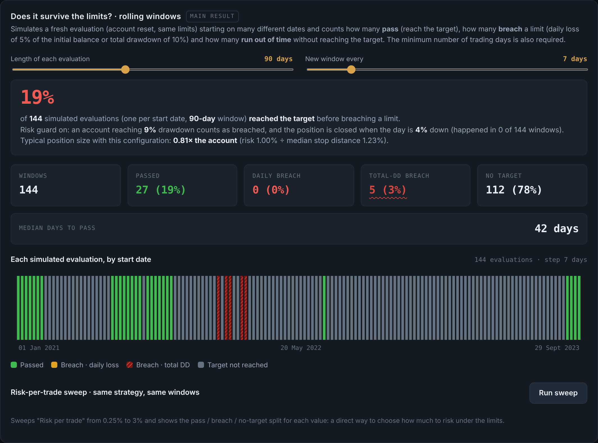

# Risk-Limit Survival Backtester

**Live app: https://gmendozaveirana.github.io/risk-limit-backtester/**

A browser-based backtester that asks a narrower question than "is this strategy profitable?": **does it survive hard risk limits?** It simulates a fresh account on many start dates and counts how often a systematic strategy reaches a profit target before breaching a daily-loss limit or a maximum drawdown. It also tests whether the edge is real or only market beta.

It runs entirely in the browser, with no server and no build step. BTCUSD perpetual hourly data from Binance (2021–2024) is preloaded; with it, 2021–2023 is in-sample and 2024 is the sealed out-of-sample. Any other OHLC CSV, such as a MetaTrader 5 export, can be loaded locally; files never leave the browser.



## What it does

| Module | Question it answers | Method |
|---|---|---|
| Rolling windows | How often does the strategy pass, breach or run out of time? | Fresh account every *n* days over the in-sample period, with intrabar worst-case checks of the daily-loss and drawdown limits |
| Risk sweep | How much risk per trade can the limits absorb? | Same windows, risk per trade from 0.25% to 3% |
| Monte Carlo | What is the drawdown distribution? | Trade bootstrap: i.i.d. or stationary block bootstrap (Politis–Romano) to keep losing streaks |
| Statistical edge | Is the expectancy distinguishable from zero? | Expectancy in R, t-statistic, one-sided bootstrap p-value, daily mark-to-market Sharpe |
| Selection vs chance | Does a multi-asset rotation add selection skill, or is it beta? | Permutation test against 2,000 random rotations with the same invested days and costs |
| Walk-forward | Does the result hold out of sample? | Date holdout or anchored folds; parameters optimised in-sample only and applied unchanged out of sample |
| Overfitting banner | How much of the in-sample edge is selection bias? | Multiple-testing threshold √(2 ln N), share of R retained out of sample, out-of-sample p-value |

## Strategies

1. EMA trend + pullback
2. Relative strength vs a reference asset
3. Volatility-regime filter
4. Combined volatility and relative-strength filters
5. Session momentum (fixed entry and exit hour)
6. Intraday mean reversion
7. Multi-asset rotation (dual momentum), or daily trend following on a single asset

Every strategy supports long, short or both directions; shorts are the exact mirror of longs. Every strategy shares the same sizing, cost, lot-rounding and account-limit settings.

## Modelling choices

- **Sizing:** risk per trade ÷ stop distance, capped by maximum leverage. Optional lot rounding uses the contract specification.
- **Costs:** spread (read from the CSV when present) and commission are charged on every trade.
- **Daily loss:** measured from the higher of balance and equity at midnight (conservative), or from the balance only.
- **Stops:** an exit at the stop never books more than the stop loss. A bar that gaps beyond the stop fills at the open.
- **Sealed holdout:** every result card uses the in-sample period only. The out-of-sample period is used only by the walk-forward.
- **Limitations:** hourly bars, no slippage model and no weekend-gap model.

## Data

- `data/BTCUSD_H1.csv`: Binance BTCUSD coin-margined perpetual, 1-hour bars, 2021-01-01 → 2024-12-31, UTC, converted with `tools/prepare_btc.py`.
- Index data used in the author's own research is not redistributed. Load your own export to test indices.

## Run locally

```bash
python -m http.server 8000
# open http://localhost:8000
```

## Disclaimer

Research and educational tool. Simulated results do not guarantee future results. Not investment advice.
